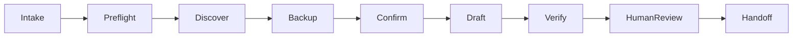

# Xsolla Game Web Portal — Agentic Onboarding Specification

## Requirements

### Acceptance scenarios

1. **Platform:** GIVEN no store URL, WHEN the title is confirmed as PC and
   approved metadata/assets are supplied, THEN continue without Steam parsing.
   GIVEN a store URL, its exact host must be `store.steampowered.com`; Mobile,
   unknown, invalid, or spoofed supplied URLs return `needs_input`. GIVEN a Steam URL and
   `steam_assets_approved: yes`, THEN the plan uses its app details' art and facts, with
   the copy shown word for word; GIVEN `no` or no answer, THEN nothing from the page is used
   and the intake says the draft keeps the template's art.
2. **The partner's site:** WHEN onboarding starts, THEN the first message, before any
   question, says to create the site from the template if it doesn't exist yet, and what the
   run changes versus what stays an Editor step. GIVEN the partner created the site from the
   Multi-page web portal template, THEN inspect it and add only the missing
   sections, without duplicates; ambiguous matches require selection. GIVEN no site at
   the domain, THEN return `needs_human`: the agent never creates a site. GIVEN a site
   without `/news`, `/rewards` or `/store`, THEN return `needs_input`: it wasn't made from
   the template.
3. **Access:** GIVEN a mutation returns `401/403`, WHEN work is partial, THEN
   preserve the ledger, return `needs_access`, reauthenticate, re-read, resume.
4. **Login:** GIVEN sign-in succeeds, WHEN binding fails, THEN Login and
   onboarding remain incomplete until binding is verified.
5. **Publication:** GIVEN the draft is ready, WHEN the run ends, THEN the agent has
   not published, run the readiness check, or generated a preview, and the handoff
   lists those as `needs_human` steps for Publisher Account.
6. **Launcher:** GIVEN a Launcher exists, WHEN build, installer, or download
   evidence is missing, THEN Launcher is incomplete and publish-anyway is
   refused.
7. **Handoff:** GIVEN the run ends, WHEN reporting, THEN repeat merchant ID,
   project ID, domain, locale, and Steam URL only if supplied, with evidence for
   every Completed item.
8. **What the partner sees:** GIVEN any progress message or the handoff, THEN it links the
   Editor and says the public URL loads only after the first publish. GIVEN a section
   reads back right, WHEN its page wasn't looked at in the Editor, THEN it isn't Completed.

## Design

### Flow



Readiness check, preview, publication, live verification and rollback come after the
handoff and belong to the human, in Publisher Account.

### Status, ledger, resume

Statuses, the ledger, resume, and the handoff report are the
[onboarding contract](../../nocode-shop-setup/references/onboarding-contract.md). This file adds
the portal's own states and evidence.

### Evidence contract

| State | Required evidence | Stop condition |
|---|---|---|
| Preflight | CLI context, PC confirmation, Steam host if supplied, domain search | Missing/ambiguous required input |
| Discover | Existing IDs, supported type and skills | Unsupported structure |
| Backup | Export directory of the existing site, before the first write | Export failed |
| Confirm | Explicit approval of the shown plan | Approval missing |
| Draft | Mutation response and read-back | Read-back mismatch |
| Verify | Structure and localization read back, matching the plan | Pending/failed verification |
| HumanReview | Approval and disclosed gaps | Approval missing |
| Handoff | Full context, statuses, evidence, human next steps | Completed lacks evidence |

### Existing vs desired

Before mutation:

| Existing state | Desired state | Action |
|---|---|---|
| Verified entity ID and values | Requested change | Create, update, ask, or stop |

Never recreate discovered existing entities.

## Handoff: the portal's Storefront section

The run itself follows the steps in [SKILL.md](../SKILL.md). The handoff is the onboarding
report in the [onboarding contract](../../nocode-shop-setup/references/onboarding-contract.md#handoff-report).
The portal fills its **Storefront** section with:

```markdown
- Steam URL (include only if supplied):
- Editor: https://publisher.xsolla.com/<merchant_id>/projects/<project_id>/site-builder/<domain>/editor
- The public URL loads only after the first publish.

| Section | Page ID | Route | Status | Evidence |
|---|---|---|---|---|

Before publishing, in Publisher Account:
- Reload the Editor before checking the portal: it doesn't refresh after CLI writes yet
- Recalculate the theme, if the run changed it, and check every page uses the global theme
- In the layout: the logo, the menu (add the pages the agent added), store buttons, social
  links and the footer
- Run the readiness check and open the preview
- Publish the main page first, then confirm the public URL
```

## After the human publishes

If the partner comes back after publishing, a resumed run may read the public site
and report what it sees. HTTP 200 with stale content is incomplete; the expected
version and routes, working Login and binding, and verified Web Shop/Launcher
outcomes are what the partner is asked to confirm.

Honest partial completion is correct. Simulated completion is failure.
